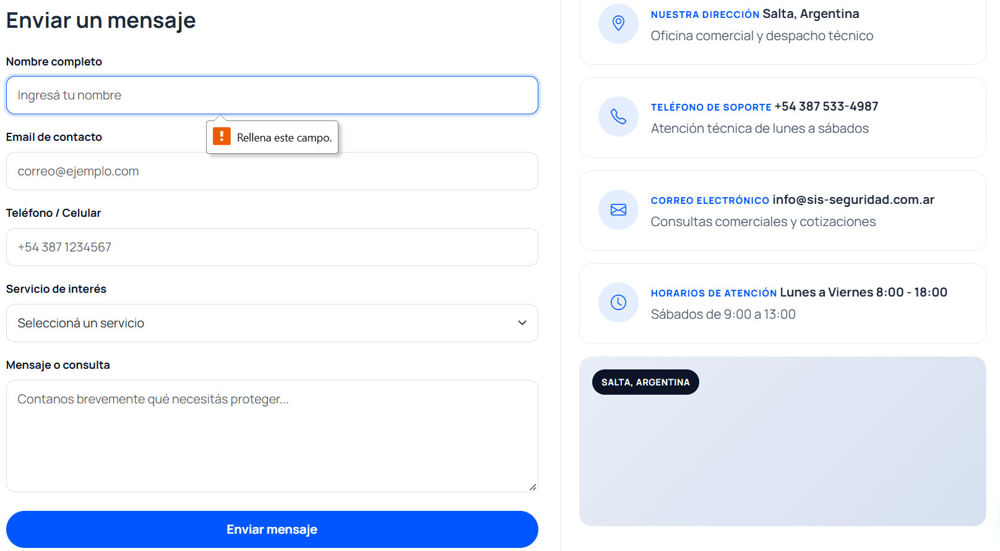
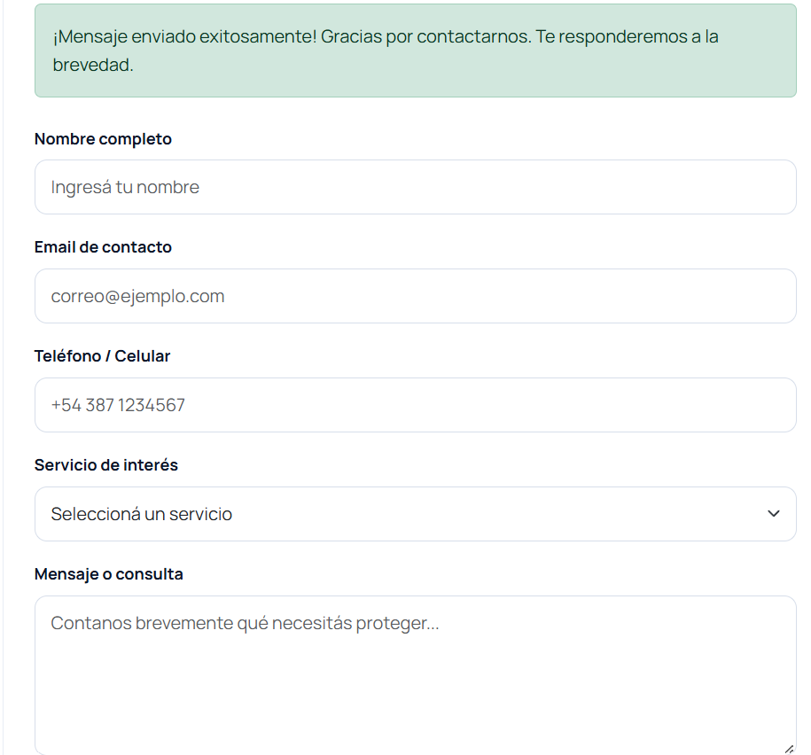
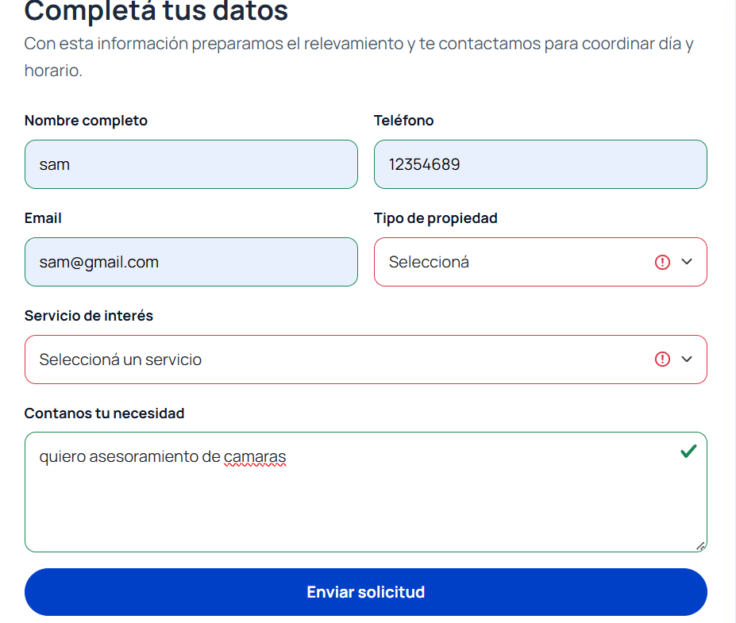
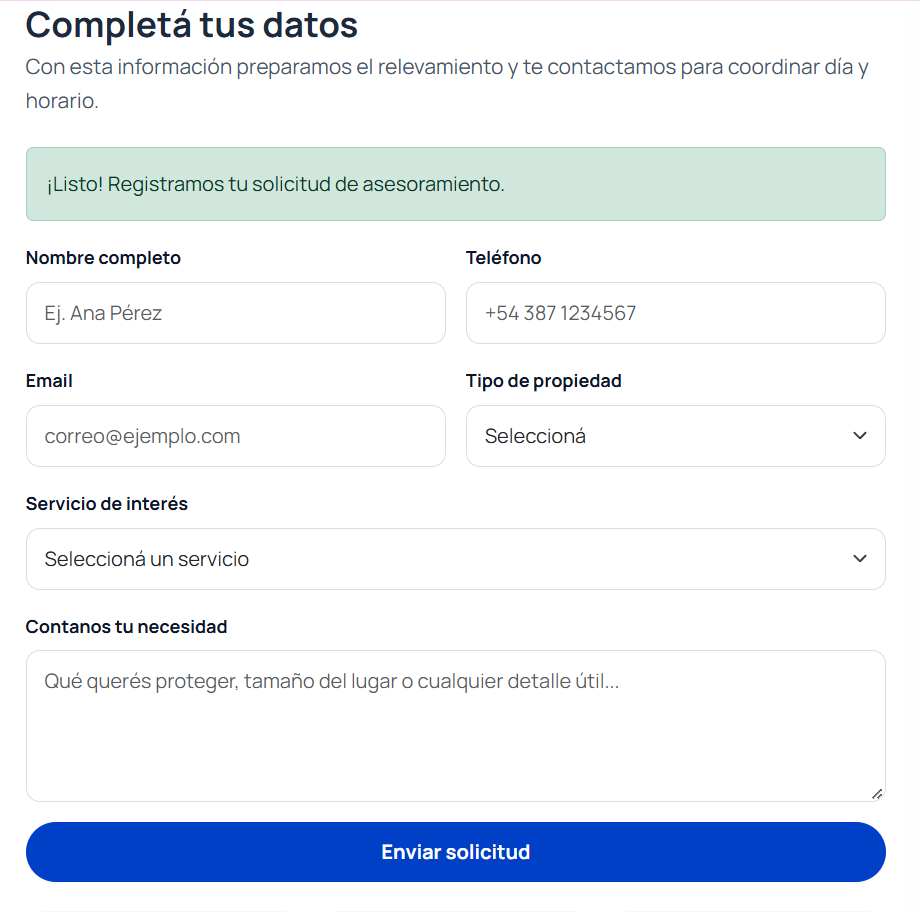
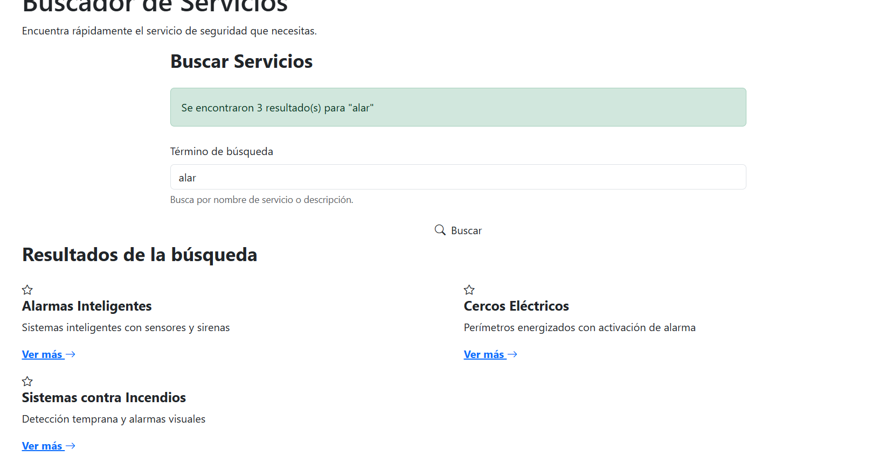
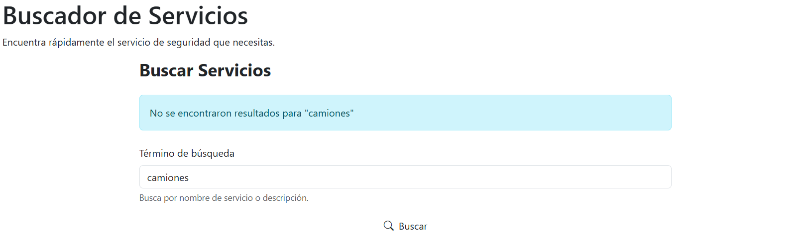
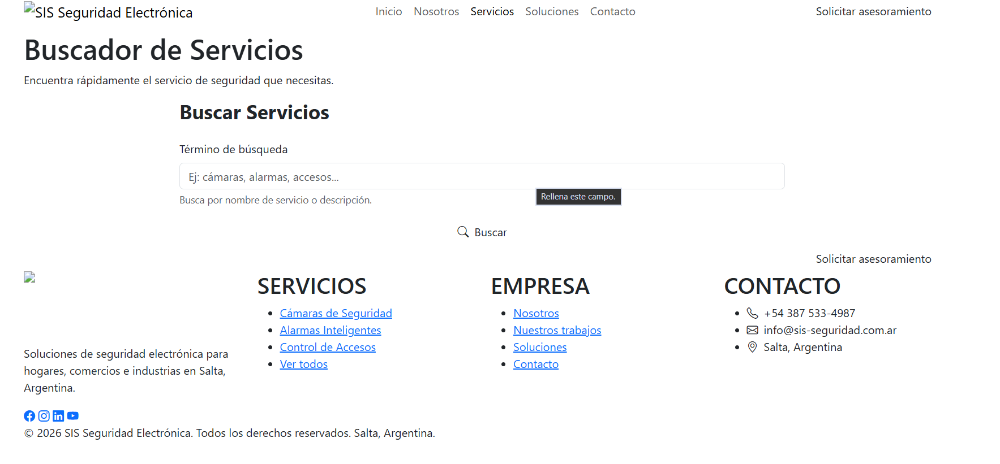

# Clase 5 - Procesamiento de Formularios y Seguridad Web

## Descripción

En esta unidad se implementó el procesamiento dinámico de formularios con PHP, aplicando las mejores prácticas de seguridad web según OWASP Top 10 para prevenir ataques de Cross-Site Scripting (XSS).

## Formularios Implementados

### 1. Formulario POST - Contacto (contacto.php)

**Lógica de Procesamiento:**
- Captura de datos mediante método POST
- Sanitización estricta usando `filter_input()` con filtros específicos:
  - `FILTER_SANITIZE_SPECIAL_CHARS` para campos de texto
  - `FILTER_SANITIZE_EMAIL` para validación de email
  - `trim()` para eliminar espacios en blanco
- Validación en servidor:
  - Verificación de campos vacíos con `empty()`
  - Validación de formato de email con `filter_var()` y `FILTER_VALIDATE_EMAIL`
  - Validación de longitud mínima de campos
- Persistencia de datos: En caso de error, los inputs conservan sus valores mediante `value="<?= htmlspecialchars($nombre); ?>"`
- Mensajes de retroalimentación: Alertas Bootstrap con colores según tipo (success/danger)
- Prevención XSS: Todos los datos mostrados en pantalla pasan por `htmlspecialchars()`

**Validaciones Implementadas:**
- Nombre: mínimo 3 caracteres
- Email: formato válido con validación de email
- Teléfono: campo obligatorio
- Servicio: selección obligatoria
- Mensaje: mínimo 10 caracteres




### 2. Formulario POST - Asesoramiento (asesoramiento.php)

**Lógica de Procesamiento:**
- Captura de datos mediante método POST
- Sanitización estricta con los mismos filtros que el formulario de contacto
- Validación en servidor:
  - Verificación de campos requeridos (nombre, teléfono, email, tipo de propiedad, servicio, mensaje)
  - Validación de formato de email
  - Validación de longitud mínima
- Persistencia de datos: Inputs mantienen valores en caso de error
- Mensajes de retroalimentación específicos por campo
- Prevención XSS con `htmlspecialchars()` en todas las salidas

**Validaciones Implementadas:**
- Nombre: mínimo 3 caracteres
- Teléfono: campo obligatorio
- Email: formato válido
- Tipo de propiedad: selección obligatoria
- Servicio: selección obligatoria
- Mensaje: mínimo 10 caracteres




### 3. Formulario GET - Buscador de Servicios (clase5/buscador.php)

**Lógica de Procesamiento:**
- Captura de parámetro mediante método GET
- Sanitización estricta del término de búsqueda con `filter_input(INPUT_GET, 'termino', FILTER_SANITIZE_SPECIAL_CHARS)`
- Validación en servidor:
  - Verificación de campo vacío
  - Validación de longitud mínima (3 caracteres)
- Simulación de búsqueda en array de servicios con búsqueda case-insensitive
- Persistencia de datos: El input mantiene el término buscado
- Mensajes de retroalimentación con información de cantidad de resultados
- Prevención XSS: Término de búsqueda y resultados mostrados con `htmlspecialchars()`

**Características:**
- Búsqueda en títulos y descripciones de servicios
- Muestra de resultados en cards con enlaces a páginas correspondientes
- Manejo de casos: resultados encontrados, sin resultados, búsqueda inválida
- Accesible desde la página principal mediante tarjeta de servicio





## Medidas de Seguridad Implementadas

### Sanitización de Entradas (OWASP Top 10 - XSS Prevention)

1. **Uso de `filter_input()` y `filter_var()`:**
   - Aplicación de filtros nativos de PHP para sanitización
   - Filtros específicos según tipo de dato (email, special chars)

2. **Sanitización con `trim()`:**
   - Eliminación de espacios en blanco al inicio y final
   - Previene envíos vacíos con solo espacios

3. **Escaping de salida con `htmlspecialchars()`:**
   - Convierte caracteres especiales a entidades HTML
   - Previene ejecución de scripts maliciosos en el navegador
   - Aplicado a todos los datos mostrados en pantalla

### Validación en Servidor

1. **Verificación de campos requeridos:**
   - Uso de `empty()` para detectar campos vacíos
   - Mensajes de error específicos por campo

2. **Validación de formatos:**
   - Email validado con `filter_var()` y `FILTER_VALIDATE_EMAIL`
   - Longitud mínima de campos (nombre, mensaje, búsqueda)

3. **Persistencia de datos:**
   - En caso de error, los inputs mantienen sus valores
   - Mejora la experiencia de usuario evitando reescritura

### Mensajes de Retroalimentación

- Alertas Bootstrap con colores semánticos (success, danger, warning, info)
- Listado detallado de errores de validación
- Mensajes claros de éxito con confirmación de acción

## Estructura de Archivos

```
clase5/
└── buscador.php          # Formulario GET con búsqueda de servicios

contacto.php             # Formulario POST de contacto (actualizado)
asesoramiento.php        # Formulario POST de asesoramiento (actualizado)
index.php                # Página principal con enlace al buscador (actualizado)
```

## Tecnologías y Funciones PHP Utilizadas

- `$_SERVER["REQUEST_METHOD"]` - Detectar método HTTP
- `filter_input()` - Sanitización de entradas
- `filter_var()` - Validación de datos
- `FILTER_SANITIZE_SPECIAL_CHARS` - Sanitización contra XSS
- `FILTER_SANITIZE_EMAIL` - Sanitización de email
- `FILTER_VALIDATE_EMAIL` - Validación de formato email
- `trim()` - Eliminar espacios en blanco
- `htmlspecialchars()` - Escaping de salida (XSS prevention)
- `empty()` - Verificar campos vacíos
- `strlen()` - Validar longitud de cadenas
- `stripos()` - Búsqueda case-insensitive
