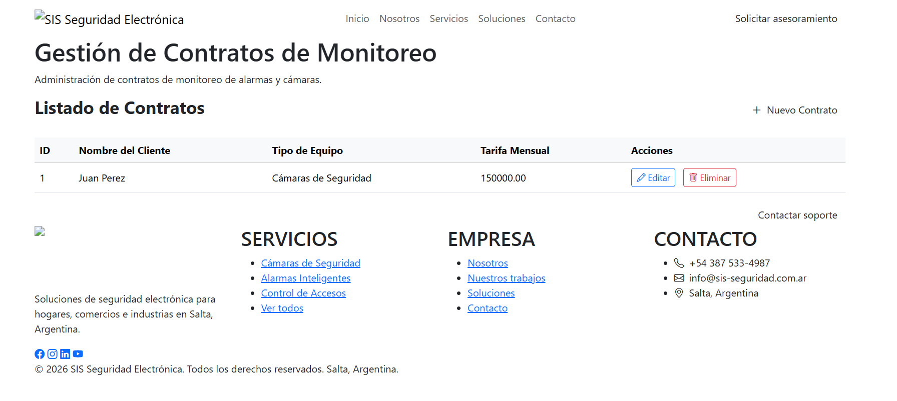
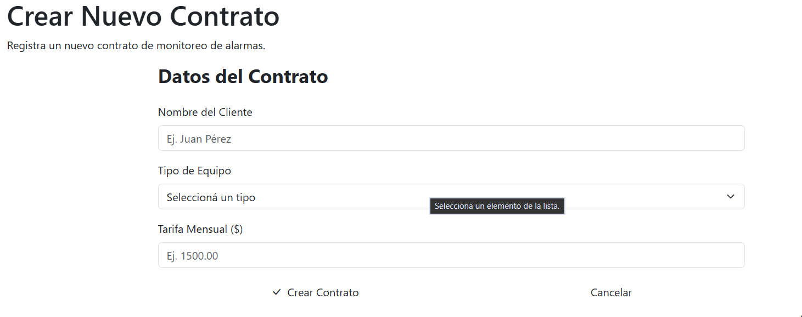
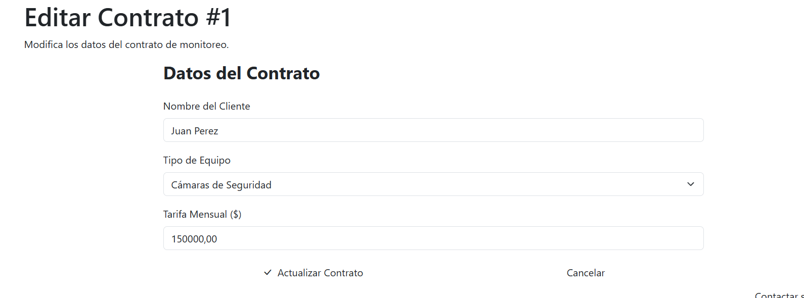
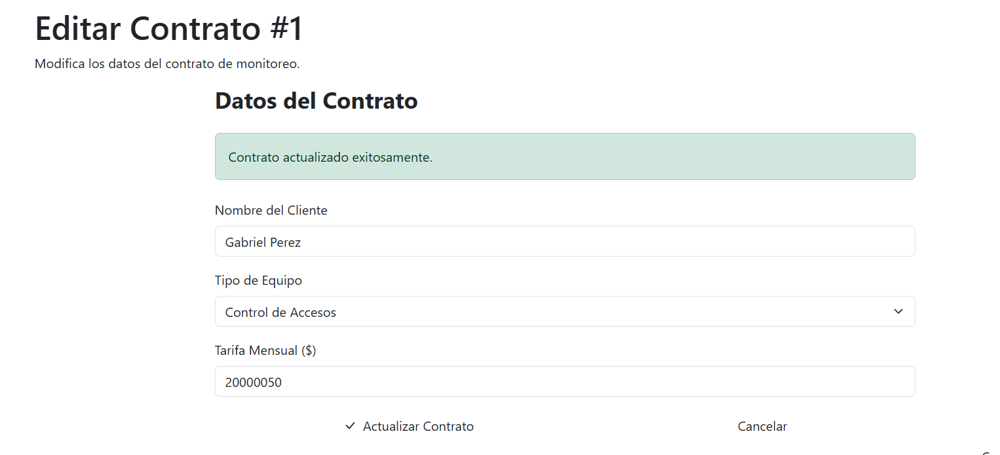
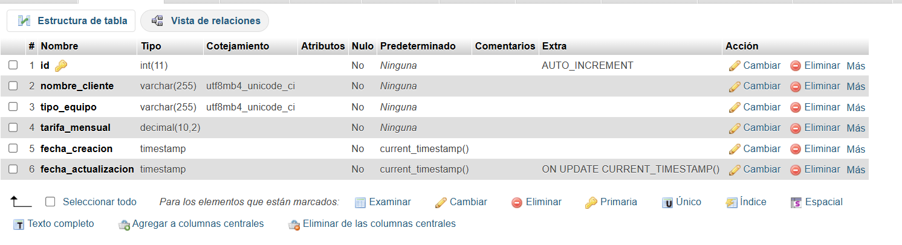
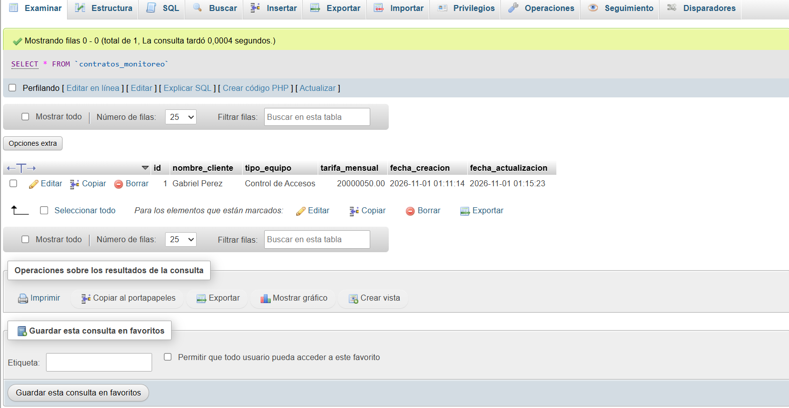

# Clase 7 - Persistencia y Conexión PHP-MySQL Segura

## Descripción

En esta unidad se implementó la conexión entre PHP y MySQL utilizando PDO (PHP Data Objects), construyendo un módulo CRUD (Create, Read, Update, Delete) totalmente funcional para la gestión de contratos de monitoreo de alarmas y cámaras.

## Entidad Manipulada

**Tabla: contratos_monitoreo**

Campos:
- `id` - Identificador único (auto_increment, primary key)
- `nombre_cliente` - Nombre del cliente (varchar 255)
- `tipo_equipo` - Tipo de equipo instalado (varchar 255)
- `tarifa_mensual` - Tarifa mensual del servicio (decimal 10,2)
- `fecha_creacion` - Fecha de creación del contrato (timestamp)
- `fecha_actualizacion` - Fecha de última actualización (timestamp)

## Archivos Implementados

### 1. Conexión a la Base de Datos (config/conexion.php)

**Características:**
- Instancia PDO con manejo de excepciones
- Bloque try-catch para capturar PDOException
- Configuración de atributos:
  - `PDO::ATTR_ERRMODE` => `PDO::ERRMODE_EXCEPTION`
  - `PDO::ATTR_DEFAULT_FETCH_MODE` => `PDO::FETCH_ASSOC`
  - Charset utf8mb4 para soporte de caracteres especiales

### 2. Operaciones CRUD (Carpeta admin/)

**index.php - Listado (Read):**
- Consulta segura con prepared statement
- Tabla HTML con Bootstrap para mostrar contratos
- Botones para editar y eliminar cada registro
- Mensaje cuando no hay contratos registrados

**crear.php - Formulario de Alta (Create):**
- Formulario HTML con validación en servidor
- Sanitización de entradas con filter_input()
- Prepared statement para inserción segura
- Mensajes de retroalimentación (éxito/error)
- Persistencia de datos en caso de error

**editar.php - Formulario de Edición (Update):**
- Captura y validación del ID por GET
- Consulta para precargar datos del contrato
- Formulario HTML con datos existentes
- Prepared statement para actualización segura
- Validación completa de campos
- Mensajes de retroalimentación

**eliminar.php - Lógica de Eliminación (Delete):**
- Captura y validación del ID por GET
- Prepared statement para eliminación segura
- Redirección al listado con confirmación
- Manejo de errores con try-catch

## Medidas de Seguridad Implementadas

### 1. Prevención de SQL Injection

**Consultas Preparadas (Prepared Statements):**
- Uso estricto de marcadores con nombre (`:parametro`)
- Parámetros vinculados con `bindParam()`
- Aplicado en todas las sentencias SQL:
  - INSERT (crear.php)
  - SELECT (index.php, editar.php)
  - UPDATE (editar.php)
  - DELETE (eliminar.php)

**Ejemplo de consulta preparada:**
```php
$sql = "INSERT INTO contratos_monitoreo (nombre_cliente, tipo_equipo, tarifa_mensual) VALUES (:nombre_cliente, :tipo_equipo, :tarifa_mensual)";
$stmt = $pdo->prepare($sql);
$stmt->bindParam(':nombre_cliente', $nombre_cliente);
$stmt->bindParam(':tipo_equipo', $tipo_equipo);
$stmt->bindParam(':tarifa_mensual', $tarifa_mensual);
$stmt->execute();
```

### 2. Prevención de XSS

**Sanitización de Entradas:**
- `filter_input()` con filtros específicos:
  - `FILTER_SANITIZE_SPECIAL_CHARS` para texto
  - `FILTER_SANITIZE_NUMBER_FLOAT` para números
- `trim()` para eliminar espacios en blanco

**Escaping de Salidas:**
- `htmlspecialchars()` en todas las variables impresas en HTML
- Aplicado a datos de la base de datos
- Aplicado a parámetros GET en enlaces

### 3. Validación en Servidor

**Validación de Campos:**
- Verificación de campos obligatorios con `empty()`
- Validación de longitud mínima con `strlen()`
- Validación de tipos numéricos con `is_numeric()`
- Validación de valores positivos

**Validación de IDs:**
- Sanitización de IDs con `FILTER_SANITIZE_NUMBER_INT`
- Verificación de existencia de registro antes de editar/eliminar
- Redirección segura si el ID no es válido

### 4. Manejo de Errores

**Bloques Try-Catch:**
- Captura de excepciones PDOException
- Mensajes de error claros para el usuario
- Redirección segura en caso de errores
- Rollback automático en caso de fallo

## Estructura de Archivos

```
config/
├── conexion.php              # Conexión PDO con try-catch
├── crear_tabla.sql          # Script SQL para crear la tabla
└── INSTRUCCIONES_CRUD.md    # Instrucciones de configuración

admin/
├── index.php                # Listado de contratos (Read)
├── crear.php                # Formulario de alta (Create)
├── editar.php               # Formulario de edición (Update)
└── eliminar.php             # Lógica de eliminación (Delete)
```

## Tecnologías y Funciones PHP Utilizadas

- `PDO` - PHP Data Objects para conexión a base de datos
- `PDOException` - Excepciones de PDO
- `prepare()` - Preparar consultas SQL
- `bindParam()` - Vincular parámetros a prepared statements
- `execute()` - Ejecutar consultas preparadas
- `query()` - Ejecutar consultas simples
- `fetchAll()` - Obtener todos los resultados
- `fetch()` - Obtener un resultado
- `filter_input()` - Sanitización de entradas
- `FILTER_SANITIZE_NUMBER_INT` - Sanitización de enteros
- `FILTER_SANITIZE_NUMBER_FLOAT` - Sanitización de decimales
- `FILTER_SANITIZE_SPECIAL_CHARS` - Sanitización de texto
- `htmlspecialchars()` - Escaping de salida (XSS prevention)
- `header()` - Redirección HTTP
- `exit()` - Terminar ejecución del script

## Evidencia de Funcionamiento

### Listado de Contratos


### Formulario de Crear


### Formulario de Editar


### Contrato Editado


### Estructura de la Tabla en phpMyAdmin


### Datos en Base de Datos


## Configuración de la Base de Datos

**Base de Datos:** sis_seguridad
**Charset:** utf8mb4
**Collation:** utf8mb4_unicode_ci

**Instrucciones de instalación:**
1. Ejecutar el script SQL en `config/crear_tabla.sql`
2. Configurar credenciales en `config/conexion.php` si es necesario
3. Acceder al módulo en `admin/index.php`

## Links de Acceso para Demostración

**Sitio Principal:**
- Inicio: http://localhost/Programacion-Web/index.php

**TP5 - Procesamiento de Formularios:**
- Formulario POST (Contacto): http://localhost/Programacion-Web/contacto.php
- Formulario POST (Asesoramiento): http://localhost/Programacion-Web/asesoramiento.php
- Formulario GET (Buscador): http://localhost/Programacion-Web/clase5/buscador.php

**TP7 - Módulo CRUD (Contratos de Monitoreo):**
- Listado de Contratos: http://localhost/Programacion-Web/admin/index.php
- Crear Contrato: http://localhost/Programacion-Web/admin/crear.php
- Editar Contrato: http://localhost/Programacion-Web/admin/editar.php?id=1
- Eliminar Contrato: http://localhost/Programacion-Web/admin/eliminar.php?id=1

**TP8 - Autenticación y Sesiones:**
- Registro: http://localhost/Programacion-Web/auth/registro.php
- Login: http://localhost/Programacion-Web/auth/login.php
- Panel de Administración: http://localhost/Programacion-Web/auth/admin_panel.php
- Gestión de Usuarios: http://localhost/Programacion-Web/auth/gestion_usuarios.php
- Logout: http://localhost/Programacion-Web/auth/logout.php

**Base de Datos:**
- phpMyAdmin: http://localhost/phpmyadmin
- Base de datos: sis_seguridad
- Eliminar Contrato: http://localhost/Programacion-Web/admin/eliminar.php?id=1

**Base de Datos:**
- phpMyAdmin: http://localhost/phpmyadmin
- Base de datos: sis_seguridad
- Tabla: contratos_monitoreo
- Tabla: usuarios

## Requisitos del Sistema

- PHP 7.4 o superior
- MySQL 5.7 o superior
- Extensión PDO habilitada
- Extensión PDO MySQL habilitada
- Servidor web local (XAMPP/Laragon)
