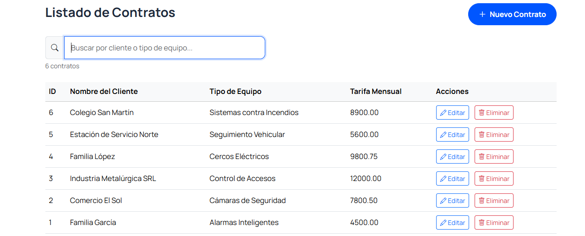
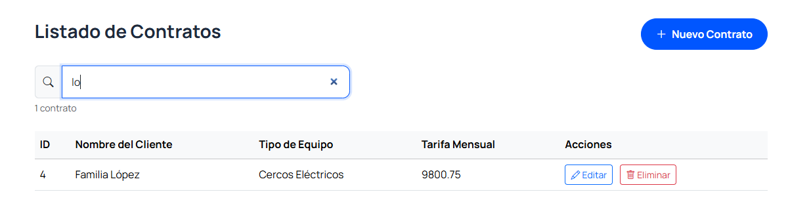

# TP 9 - Comunicación Asincrónica y APIs (AJAX & JSON)

## Descripción

En esta unidad se implementó comunicación asincrónica cliente-servidor mediante Fetch API y el formato JSON, permitiendo consultar información de la base de datos de manera dinámica y en tiempo real, sin recargar la página (interacción reactiva).

La funcionalidad elegida es una **búsqueda en vivo de contratos de monitoreo** en el panel de administración: al escribir en el campo de búsqueda, la tabla se filtra consultando MySQL mediante una petición AJAX, actualizando únicamente el `<tbody>` del listado.

## Archivos Implementados

### 1. Endpoint Backend (api/buscar_contratos.php)

**Características:**
- Configuración del encabezado `Content-Type: application/json; charset=utf-8`
- Control de acceso: requiere sesión iniciada con rol `admin`; responde `401 Unauthorized` en JSON si no está autenticado
- Validación del parámetro `q` (GET): verifica que sea string, aplica `trim()` y limita longitud máxima
- Consulta segura con prepared statement y `bindParam()` sobre `contratos_monitoreo`
- Búsqueda con `LIKE` sobre `nombre_cliente` y `tipo_equipo`
- Serialización de resultados con `json_encode()` y `JSON_UNESCAPED_UNICODE`
- Códigos de estado HTTP apropiados: `200 OK`, `400 Bad Request`, `401 Unauthorized`, `500 Internal Server Error`

**Estructura de respuesta exitosa:**
```json
{
  "status": "success",
  "data": [
    {
      "id": 1,
      "nombre_cliente": "Juan Pérez",
      "tipo_equipo": "Alarmas Inteligentes",
      "tarifa_mensual": "1500.00"
    }
  ]
}
```

### 2. Lógica Frontend (js/admin-contratos.js)

**Características:**
- Escucha del evento `input` sobre el campo de búsqueda
- Debounce de 300 ms para evitar una petición por cada tecla
- Petición asincrónica con `fetch()` y `async/await`
- Uso de `encodeURIComponent()` para codificar el término de búsqueda
- Manejo de errores con `try...catch` y verificación de `response.ok`
- Renderizado dinámico del DOM: construye las filas de la tabla como strings HTML
- Prevención de XSS en el frontend mediante función `escapeHtml()` aplicada a todos los datos recibidos
- Estado vacío diferenciado: "No hay contratos registrados" vs "No se encontraron contratos para la búsqueda"
- Indicador de estado accesible (`aria-live`) con cantidad de resultados

### 3. Integración en el Listado (admin/index.php)

- Campo de búsqueda con `type="search"` e `input-group` de Bootstrap
- Atributo `id="tabla-contratos-body"` en el `<tbody>` para renderizado dinámico
- Inclusión del script `js/admin-contratos.js` solo en esta vista
- Las filas renderizadas por PHP actúan como estado inicial (progressive enhancement)

## Medidas de Seguridad Implementadas

### 1. Autenticación y Autorización en el Endpoint
- Verificación de `$_SESSION['usuario_id']` y rol `admin` antes de consultar la base de datos
- Respuesta `401` en formato JSON (no redirección HTML) para mantener el contrato de la API

### 2. Prevención de SQL Injection
- Consulta preparada con marcador con nombre (`:q`)
- Parámetro vinculado con `bindParam()`

### 3. Prevención de XSS
- `escapeHtml()` en JavaScript escapa `& < > " '` antes de insertar datos en el DOM
- Los enlaces de acción usan `encodeURIComponent()` para los IDs

### 4. Validación de Entrada
- Verificación de tipo de dato del parámetro `q`
- `trim()` y límite de longitud para evitar consultas abusivas

## Evidencia de Funcionamiento

### Listado de Contratos con Buscador en Vivo


### Resultados Filtrados sin Recarga de Página


Al escribir en el campo de búsqueda, la tabla se actualiza dinámicamente consultando el endpoint `api/buscar_contratos.php` sin recargar el navegador.

## Estructura de Archivos

```
api/
└── buscar_contratos.php        # Endpoint JSON de búsqueda de contratos

js/
└── admin-contratos.js          # Lógica AJAX de búsqueda en vivo (admin)

admin/
└── index.php                   # Listado con buscador en vivo (actualizado)
```

## Tecnologías y Funciones Utilizadas

**Backend (PHP):**
- `header()` - Encabezado `Content-Type: application/json`
- `http_response_code()` - Códigos de estado HTTP
- `json_encode()` / `JSON_UNESCAPED_UNICODE` - Serialización JSON
- `filter_input()` implícito vía `$_GET` + validación de tipo
- `trim()`, `mb_substr()` - Sanitización y límite de longitud
- `PDO::prepare()`, `bindParam()`, `fetchAll()` - Consulta segura
- `$_SESSION` - Control de acceso por rol

**Frontend (JavaScript):**
- `fetch()` - Peticiones HTTP asincrónicas
- `async/await` - Programación asíncrona basada en promesas
- `response.ok`, `response.json()` - Manejo de respuestas HTTP
- `try...catch` - Manejo de errores de red y HTTP
- `setTimeout()` / `clearTimeout()` - Debounce de eventos
- `encodeURIComponent()` - Codificación de parámetros URL
- `innerHTML`, `createElement` - Manipulación del DOM
- `addEventListener('input')` - Captura de eventos del usuario

## Links de Acceso para Demostración

**TP9 - Comunicación Asincrónica (AJAX & JSON):**
- Panel de administración con buscador en vivo: http://localhost/Programacion-Web/admin/index.php
- Endpoint API (requiere sesión admin): http://localhost/Programacion-Web/api/buscar_contratos.php?q=alarma
