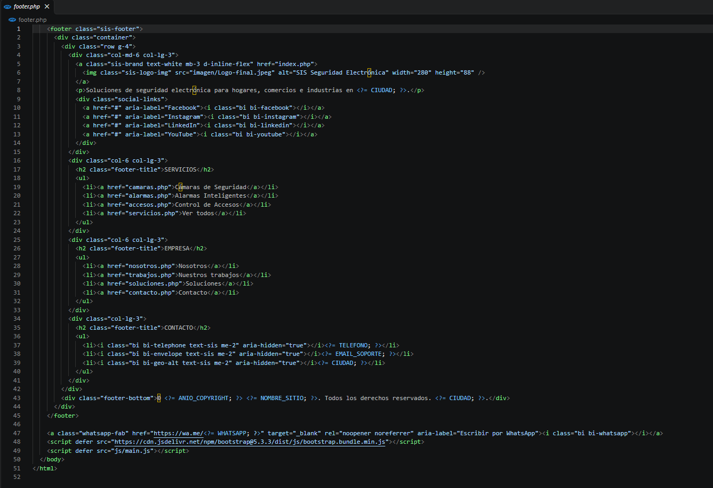
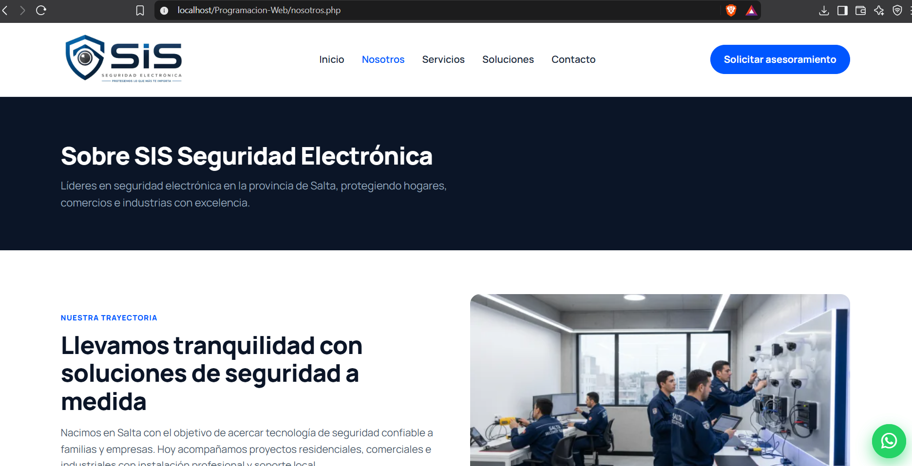

# Unidad 4 - Migración a PHP y Modularización (SSI)

## Descripción del Proyecto

Este proyecto consiste en un sitio web corporativo para **SIS Seguridad Electrónica**, una empresa de seguridad electrónica ubicada en Salta, Argentina. El sitio originalmente fue desarrollado como una maqueta estática en HTML/CSS/JavaScript y fue evolucionado en la Unidad 4 a una aplicación web basada en PHP utilizando la técnica de Server Side Includes (SSI/Modularización por plantillas).

### Refactorización Realizada

En la Unidad 4 se implementó:
- **Migración a PHP**: Todos los archivos `.html` fueron renombrados a `.php`
- **Modularización con SSI**: Extracción de componentes comunes (header, nav, footer) en plantillas reutilizables
- **Renderizado Server-Side (SSR)**: Implementación de títulos de página dinámicos y navegación activa
- **Variables de Entorno**: Configuración centralizada mediante archivo `config/env.php`
- **Eliminación de código duplicado**: Uso de `require_once` para incluir plantillas modulares

## Tecnologías Utilizadas

- **HTML5**: Estructura semántica del contenido
- **CSS3**: Estilos personalizados con variables CSS
- **Bootstrap 5.3.3**: Framework CSS para diseño responsive
- **Bootstrap Icons 1.11.3**: Iconografía del sitio
- **JavaScript**: Interactividad (acordeón FAQ, validación de formularios)
- **PHP 8.x**: Lógica server-side y modularización
- **XAMPP/Laragon**: Entorno de servidor local para ejecución
- **Git**: Control de versiones con flujo de trabajo por ramas

## Instrucciones de Instalación y Ejecución Local

### Requisitos Previos

1. Tener instalado un servidor local (XAMPP o Laragon)
2. Tener instalado Git
3. Tener un editor de código (VS Code recomendado)

### Pasos de Instalación

1. **Clonar el repositorio:**
   ```bash
   git clone [URL_DEL_REPOSITORIO]
   cd Programacion-Web
   ```

2. **Copiar el proyecto al servidor local:**
   - Si usas XAMPP: Copia la carpeta del proyecto a `C:\xampp\htdocs\`
   - Si usas Laragon: Copia la carpeta del proyecto a `C:\laragon\www\`

3. **Configurar variables de entorno (opcional):**
   - El archivo `config/env.php` ya contiene las configuraciones por defecto
   - Puedes crear un archivo `.env` local con tus propias configuraciones (este archivo no se versiona)

4. **Iniciar el servidor local:**
   - Abre el panel de control de XAMPP o Laragon
   - Inicia Apache

5. **Acceder al sitio:**
   - Abre tu navegador
   - Navega a `http://localhost/Programacion-Web/` (o el nombre de la carpeta que hayas usado)

## Estructura del Proyecto

```
Programacion-Web/
├── config/
│   └── env.php              # Variables de configuración global
├── includes/
│   ├── header.php           # Plantilla del encabezado y navegación
│   └── footer.php           # Plantilla del pie de página
├── css/
│   └── styles.css           # Hoja de estilos principal
├── js/
│   └── main.js              # Scripts JavaScript
├── imagen/                  # Imágenes del sitio
├── img/                     # Mockups y wireframes
├── index.php                # Página principal
├── nosotros.php             # Página "Nosotros"
├── servicios.php            # Página de servicios
├── contacto.php             # Página de contacto
├── soluciones.php           # Página de soluciones
├── trabajos.php             # Página de trabajos
├── asesoramiento.php        # Formulario de asesoramiento
├── camaras.php              # Página de cámaras
├── alarmas.php              # Página de alarmas
├── accesos.php              # Página de control de accesos
├── .env.example             # Plantilla de variables de entorno
├── .gitignore               # Archivos excluidos de Git
└── readme.md                # Documentación del proyecto
```

## Evidencia de Funcionamiento

### 1. Servidor Local Ejecutándose


Sitio corriendo en el navegador bajo http://localhost/Programacion-Web/

### 2. Estructura Modular (SSI)

**Header.php - Variables dinámicas y navegación:**


**Header.php - Lógica de navegación activa:**


**Footer.php - Variables de entorno:**


### 3. Navegación Dinámica


Cambio de título dinámico en la pestaña del navegador y clase active en el menú según la sección navegada.

### 4. Configuración de Variables de Entorno


Archivo config/env.php con constantes globales y plantilla .env.example presente en el repositorio.
