# TP - Diseño y planificación de sitio web

## 1. Intereses personales

Mis principales intereses están relacionados con la tecnología y la informática. Me interesa la programación, el desarrollo de páginas web, las redes, la reparación de computadoras y los sistemas de seguridad como cámaras y alarmas.

También me interesa aprender a desarrollar soluciones que puedan ser útiles para personas y empresas.

---

## 2. Tema elegido

Sitio web corporativo para una empresa de Seguridad Electrónica e Inteligente (SIS).
Justificación: Elegí este tema porque me permite aplicar mis intereses en el desarrollo web interactivo a un caso de uso real y de alta demanda. El rubro de la seguridad electrónica requiere un sitio que transmita confianza y solidez, lo que representa un gran desafío de diseño UI/UX. Además, me permite integrar herramientas interactivas que me interesan, como formularios de relevamiento a medida, botones de contacto rápido vía WhatsApp y secciones de asesoramiento dinámico para los usuarios.


## 3. Sitios web de referencia

Para este rubro, estas son 5 referencias del mercado de seguridad y tecnología con sus respectivos análisis para que incluyas en tu TP:

## ADT (adt.com.ar)

Positivos: Excelente jerarquía visual en los botones de "Llamada a la acción" (CTA); paleta de colores que transmite alerta y seguridad; buena adaptación a dispositivos móviles (responsive).

Negativos: Exceso de ventanas emergentes (pop-ups) comerciales; la carga de la página puede ser lenta por scripts de seguimiento; algunas secciones de texto son muy densas.

## Prosegur (prosegur.com.ar)

Positivos: Navegación por pestañas muy clara para separar "Hogares" de "Empresas"; portal de autogestión de clientes bien integrado; uso de iconografía intuitiva.

Negativos: El menú desplegable principal es demasiado extenso y puede confundir; los precios o planes base son difíciles de encontrar; el diseño del footer está sobrecargado de enlaces.

## X-28 Alarmas (x-28.com)

Positivos: Fuerte presencia de canales de contacto directo (WhatsApp visible en todo momento); explicaciones de productos muy directas y al grano; reconocimiento de marca local muy bien explotado.

Negativos: Interfaz de usuario (UI) un poco anticuada frente a la competencia; imágenes de producto de menor calidad; las transiciones entre páginas son algo toscas.

## Hikvision (hikvision.com)

Positivos: Fotografía de producto en altísima calidad; diseño web moderno y limpio; fichas técnicas de equipos extremadamente detalladas.

Negativos: Orientado más a instaladores/distribuidores que al consumidor final; lenguaje demasiado técnico; el mapa del sitio es muy profundo y complejo de navegar.

## Ring (ring.com)

Positivos: Interfaz minimalista y moderna orientada al "Smart Home"; excelente uso de videos cortos para demostrar cómo funciona el producto; proceso de compra integrado impecable.

Negativos: Ecosistema muy cerrado solo a sus productos; carece de secciones orientadas a soluciones empresariales complejas; soporte técnico difícil de contactar de forma directa.
# 4. Wireframes a mano

Se realizarán bocetos en papel para definir la estructura y distribución de los elementos principales del sitio web.


# 5. Mapa del sitio

La estructura general del sitio será la siguiente:
SITIO WEB
│
├── Inicio (Home)
│
├── Nosotros
│   └── La Empresa
│
├── Servicios
│   ├── Cámaras de Seguridad
│   ├── Sistemas de Alarmas
│   ├── Control de Accesos
│   ├── Cercos Eléctricos
│   ├── Seguimiento Vehicular
│   └── Sistemas contra Incendios
│
├── Soluciones
│   ├── Para Hogares
│   └── Para Comercios y Empresas
│
├── Contacto
│
└── Preguntas Frecuentes (FAQ)

## 6. WIDEFRAME EN FIGMA
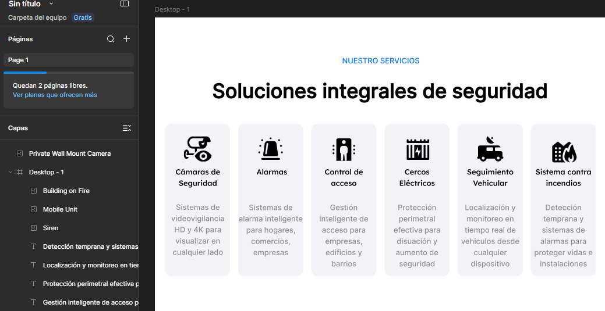

# TP - Diseño de los mackup.
## HOME


## NOSOTROS


## SERVICIOS


## CONTACTO


## URL DE FIGMA https://www.figma.com/proto/jYodboH8pYuVJKtHmK5ATe/SIS-ALARMAS?node-id=17-4&p=f&t=YtLvM4Fk3mwMH3c2-1&scaling=min-zoom&content-scaling=fixed&page-id=0%3A1&starting-point-node-id=17%3A4

---

# Unidad 4 - Migración a PHP y Modularización (SSI)

## Descripción del Proyecto

Este proyecto consiste en un sitio web corporativo para **SIS Seguridad Electrónica**, una empresa de seguridad electrónica ubicada en Salta, Argentina. El sitio originalmente fue desarrollado como una maqueta estática en HTML/CSS/JavaScript y fue evolucionado en la Unidad 4 a una aplicación web basada en PHP utilizando la técnica de Server Side Includes (SSI/Modularización por plantillas).

### Refactorización Realizada

En la Unidad 4 se implementó:
- **Migración a PHP**: Todos los archivos `.html` fueron renombrados a `.php`
- **Modularización con SSI**: Extracción de componentes comunes (header, nav, footer) en plantillas reutilizables
- **Renderizado Server-Side (SSR)**: Implementación de títulos de página dinámicos y navegación activa
- **Variables de Entorno**: Configuración centralizada mediante archivo `config/env.php`
- **Eliminación de código duplicado**: Uso de `require_once` para incluir plantillas modulares

## Tecnologías Utilizadas

- **HTML5**: Estructura semántica del contenido
- **CSS3**: Estilos personalizados con variables CSS
- **Bootstrap 5.3.3**: Framework CSS para diseño responsive
- **Bootstrap Icons 1.11.3**: Iconografía del sitio
- **JavaScript**: Interactividad (acordeón FAQ, validación de formularios)
- **PHP 8.x**: Lógica server-side y modularización
- **XAMPP/Laragon**: Entorno de servidor local para ejecución
- **Git**: Control de versiones con flujo de trabajo por ramas

## Instrucciones de Instalación y Ejecución Local

### Requisitos Previos

1. Tener instalado un servidor local (XAMPP o Laragon)
2. Tener instalado Git
3. Tener un editor de código (VS Code recomendado)

### Pasos de Instalación

1. **Clonar el repositorio:**
   ```bash
   git clone [URL_DEL_REPOSITORIO]
   cd Programacion-Web
   ```

2. **Copiar el proyecto al servidor local:**
   - Si usas XAMPP: Copia la carpeta del proyecto a `C:\xampp\htdocs\`
   - Si usas Laragon: Copia la carpeta del proyecto a `C:\laragon\www\`

3. **Configurar variables de entorno (opcional):**
   - El archivo `config/env.php` ya contiene las configuraciones por defecto
   - Puedes crear un archivo `.env` local con tus propias configuraciones (este archivo no se versiona)

4. **Iniciar el servidor local:**
   - Abre el panel de control de XAMPP o Laragon
   - Inicia Apache

5. **Acceder al sitio:**
   - Abre tu navegador
   - Navega a `http://localhost/Programacion-Web/` (o el nombre de la carpeta que hayas usado)

## Estructura del Proyecto

```
Programacion-Web/
├── config/
│   └── env.php              # Variables de configuración global
├── includes/
│   ├── header.php           # Plantilla del encabezado y navegación
│   └── footer.php           # Plantilla del pie de página
├── css/
│   └── styles.css           # Hoja de estilos principal
├── js/
│   └── main.js              # Scripts JavaScript
├── imagen/                  # Imágenes del sitio
├── img/                     # Mockups y wireframes
├── index.php                # Página principal
├── nosotros.php             # Página "Nosotros"
├── servicios.php            # Página de servicios
├── contacto.php             # Página de contacto
├── soluciones.php           # Página de soluciones
├── trabajos.php             # Página de trabajos
├── asesoramiento.php        # Formulario de asesoramiento
├── camaras.php              # Página de cámaras
├── alarmas.php              # Página de alarmas
├── accesos.php              # Página de control de accesos
├── .env.example             # Plantilla de variables de entorno
├── .gitignore               # Archivos excluidos de Git
└── readme.md                # Documentación del proyecto
```

## Evidencia de Funcionamiento

### 1. Servidor Local Ejecutándose


Sitio corriendo en el navegador bajo http://localhost/Programacion-Web/

### 2. Estructura Modular (SSI)

**Header.php - Variables dinámicas y navegación:**


**Header.php - Lógica de navegación activa:**


**Footer.php - Variables de entorno:**
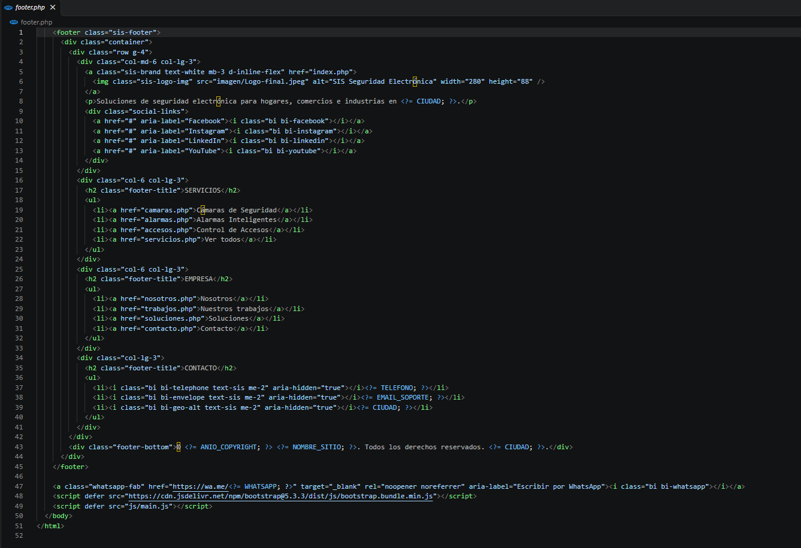

### 3. Navegación Dinámica
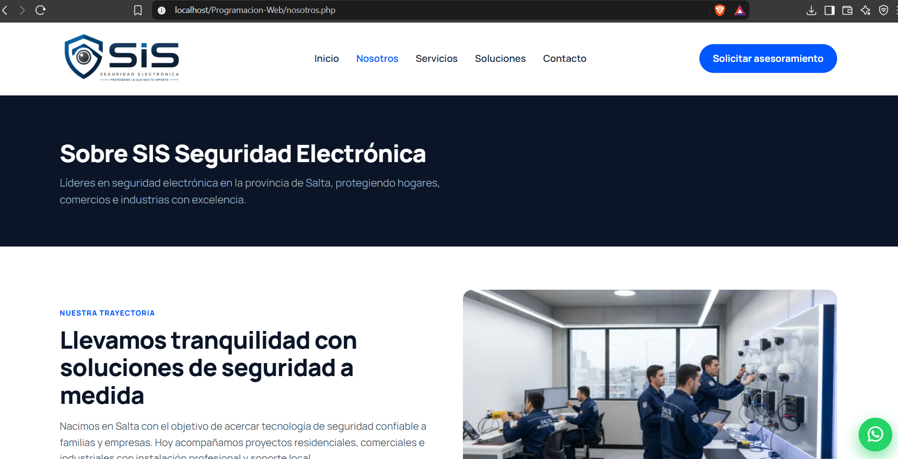

Cambio de título dinámico en la pestaña del navegador y clase active en el menú según la sección navegada.

### 4. Configuración de Variables de Entorno


Archivo config/env.php con constantes globales y plantilla .env.example presente en el repositorio.

---

# Clase 5 - Procesamiento de Formularios y Seguridad Web

## Descripción

En esta unidad se implementó el procesamiento dinámico de formularios con PHP, aplicando las mejores prácticas de seguridad web según OWASP Top 10 para prevenir ataques de Cross-Site Scripting (XSS).

## Formularios Implementados

### 1. Formulario POST - Contacto (contacto.php)

**Lógica de Procesamiento:**
- Captura de datos mediante método POST
- Sanitización estricta usando `filter_input()` con filtros específicos:
  - `FILTER_SANITIZE_SPECIAL_CHARS` para campos de texto
  - `FILTER_SANITIZE_EMAIL` para validación de email
  - `trim()` para eliminar espacios en blanco
- Validación en servidor:
  - Verificación de campos vacíos con `empty()`
  - Validación de formato de email con `filter_var()` y `FILTER_VALIDATE_EMAIL`
  - Validación de longitud mínima de campos
- Persistencia de datos: En caso de error, los inputs conservan sus valores mediante `value="<?= htmlspecialchars($nombre); ?>"`
- Mensajes de retroalimentación: Alertas Bootstrap con colores según tipo (success/danger)
- Prevención XSS: Todos los datos mostrados en pantalla pasan por `htmlspecialchars()`

**Validaciones Implementadas:**
- Nombre: mínimo 3 caracteres
- Email: formato válido con validación de email
- Teléfono: campo obligatorio
- Servicio: selección obligatoria
- Mensaje: mínimo 10 caracteres

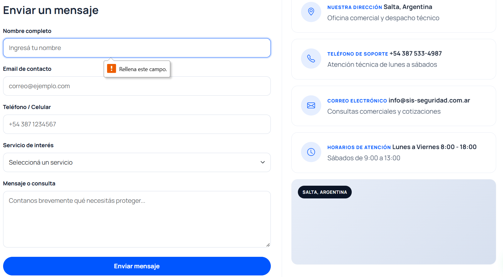
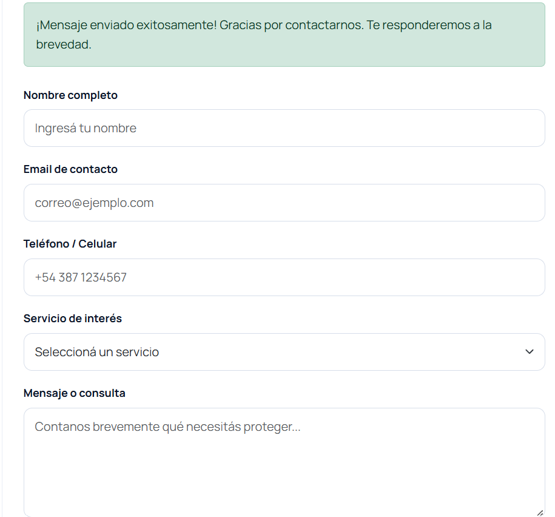

### 2. Formulario POST - Asesoramiento (asesoramiento.php)

**Lógica de Procesamiento:**
- Captura de datos mediante método POST
- Sanitización estricta con los mismos filtros que el formulario de contacto
- Validación en servidor:
  - Verificación de campos requeridos (nombre, teléfono, email, tipo de propiedad, servicio, mensaje)
  - Validación de formato de email
  - Validación de longitud mínima
- Persistencia de datos: Inputs mantienen valores en caso de error
- Mensajes de retroalimentación específicos por campo
- Prevención XSS con `htmlspecialchars()` en todas las salidas

**Validaciones Implementadas:**
- Nombre: mínimo 3 caracteres
- Teléfono: campo obligatorio
- Email: formato válido
- Tipo de propiedad: selección obligatoria
- Servicio: selección obligatoria
- Mensaje: mínimo 10 caracteres

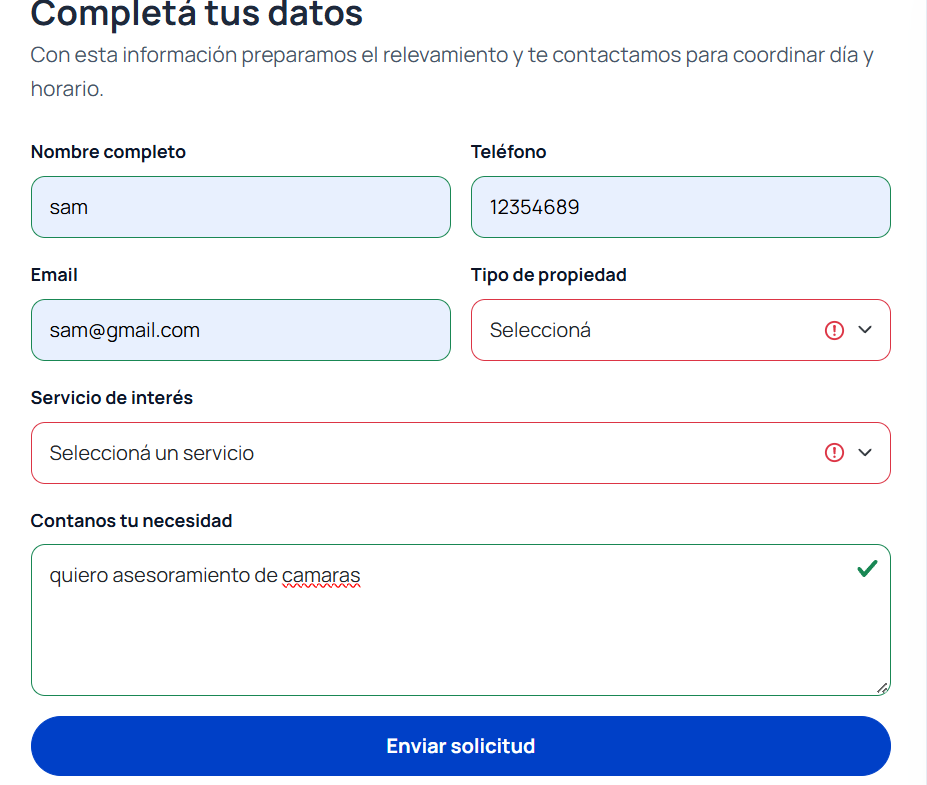
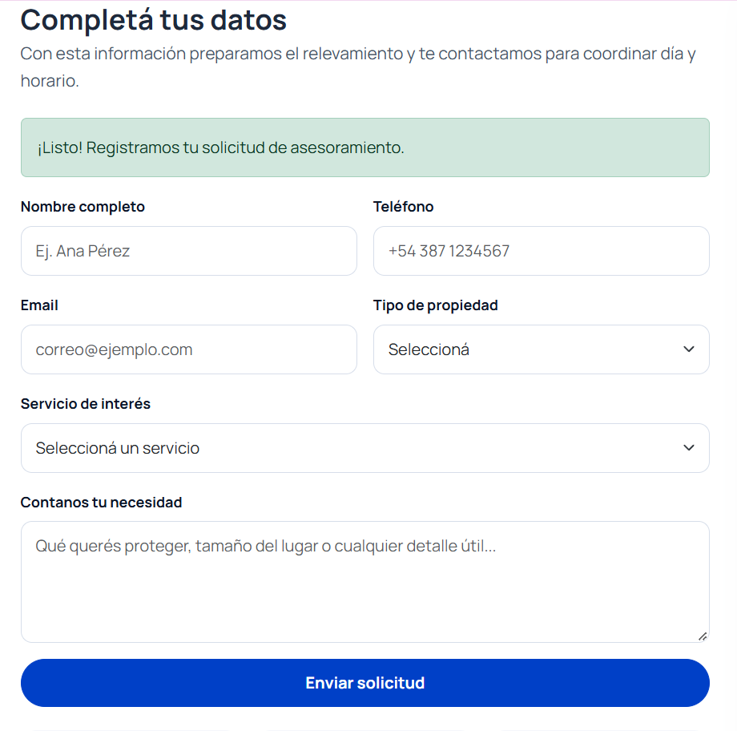

### 3. Formulario GET - Buscador de Servicios (clase5/buscador.php)

**Lógica de Procesamiento:**
- Captura de parámetro mediante método GET
- Sanitización estricta del término de búsqueda con `filter_input(INPUT_GET, 'termino', FILTER_SANITIZE_SPECIAL_CHARS)`
- Validación en servidor:
  - Verificación de campo vacío
  - Validación de longitud mínima (3 caracteres)
- Simulación de búsqueda en array de servicios con búsqueda case-insensitive
- Persistencia de datos: El input mantiene el término buscado
- Mensajes de retroalimentación con información de cantidad de resultados
- Prevención XSS: Término de búsqueda y resultados mostrados con `htmlspecialchars()`

**Características:**
- Búsqueda en títulos y descripciones de servicios
- Muestra de resultados en cards con enlaces a páginas correspondientes
- Manejo de casos: resultados encontrados, sin resultados, búsqueda inválida
- Accesible desde la página principal mediante tarjeta de servicio

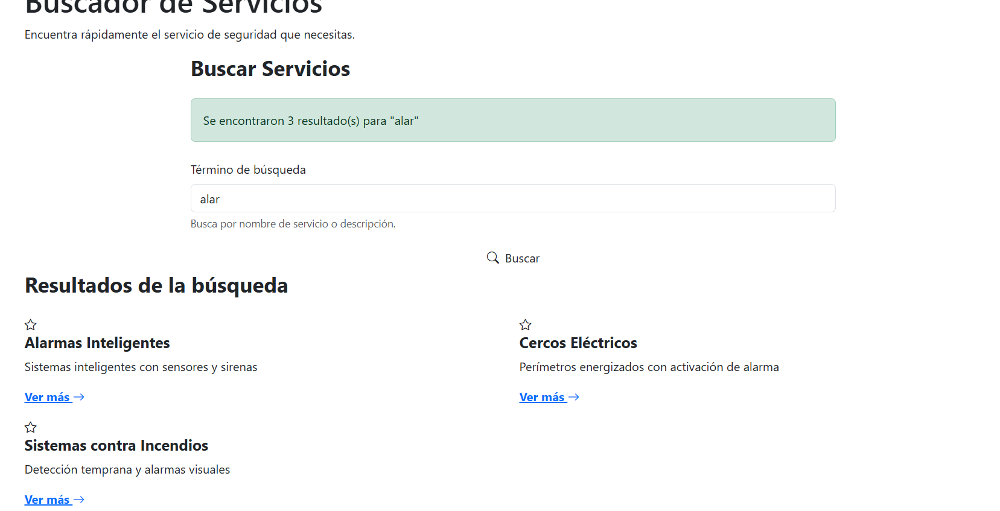
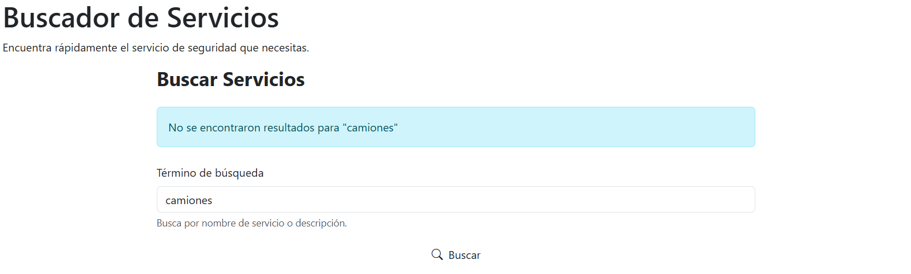
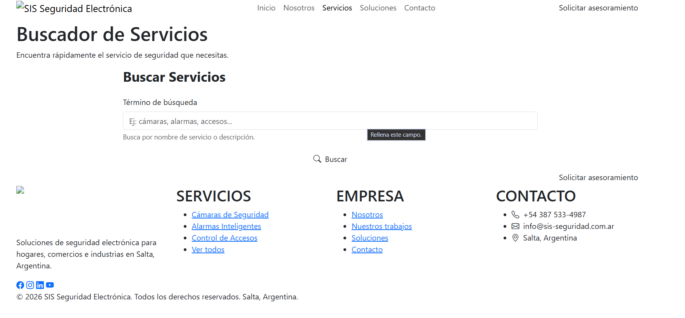

## Medidas de Seguridad Implementadas

### Sanitización de Entradas (OWASP Top 10 - XSS Prevention)

1. **Uso de `filter_input()` y `filter_var()`:**
   - Aplicación de filtros nativos de PHP para sanitización
   - Filtros específicos según tipo de dato (email, special chars)

2. **Sanitización con `trim()`:**
   - Eliminación de espacios en blanco al inicio y final
   - Previene envíos vacíos con solo espacios

3. **Escaping de salida con `htmlspecialchars()`:**
   - Convierte caracteres especiales a entidades HTML
   - Previene ejecución de scripts maliciosos en el navegador
   - Aplicado a todos los datos mostrados en pantalla

### Validación en Servidor

1. **Verificación de campos requeridos:**
   - Uso de `empty()` para detectar campos vacíos
   - Mensajes de error específicos por campo

2. **Validación de formatos:**
   - Email validado con `filter_var()` y `FILTER_VALIDATE_EMAIL`
   - Longitud mínima de campos (nombre, mensaje, búsqueda)

3. **Persistencia de datos:**
   - En caso de error, los inputs mantienen sus valores
   - Mejora la experiencia de usuario evitando reescritura

### Mensajes de Retroalimentación

- Alertas Bootstrap con colores semánticos (success, danger, warning, info)
- Listado detallado de errores de validación
- Mensajes claros de éxito con confirmación de acción

## Estructura de Archivos

```
clase5/
└── buscador.php          # Formulario GET con búsqueda de servicios

contacto.php             # Formulario POST de contacto (actualizado)
asesoramiento.php        # Formulario POST de asesoramiento (actualizado)
index.php                # Página principal con enlace al buscador (actualizado)
```

## Tecnologías y Funciones PHP Utilizadas

- `$_SERVER["REQUEST_METHOD"]` - Detectar método HTTP
- `filter_input()` - Sanitización de entradas
- `filter_var()` - Validación de datos
- `FILTER_SANITIZE_SPECIAL_CHARS` - Sanitización contra XSS
- `FILTER_SANITIZE_EMAIL` - Sanitización de email
- `FILTER_VALIDATE_EMAIL` - Validación de formato email
- `trim()` - Eliminar espacios en blanco
- `htmlspecialchars()` - Escaping de salida (XSS prevention)
- `empty()` - Verificar campos vacíos
- `strlen()` - Validar longitud de cadenas
- `stripos()` - Búsqueda case-insensitive

---

# Clase 7 - Persistencia y Conexión PHP-MySQL Segura

## Descripción

En esta unidad se implementó la conexión entre PHP y MySQL utilizando PDO (PHP Data Objects), construyendo un módulo CRUD (Create, Read, Update, Delete) totalmente funcional para la gestión de contratos de monitoreo de alarmas y cámaras.

## Entidad Manipulada

**Tabla: contratos_monitoreo**

Campos:
- `id` - Identificador único (auto_increment, primary key)
- `nombre_cliente` - Nombre del cliente (varchar 255)
- `tipo_equipo` - Tipo de equipo instalado (varchar 255)
- `tarifa_mensual` - Tarifa mensual del servicio (decimal 10,2)
- `fecha_creacion` - Fecha de creación del contrato (timestamp)
- `fecha_actualizacion` - Fecha de última actualización (timestamp)

## Archivos Implementados

### 1. Conexión a la Base de Datos (config/conexion.php)

**Características:**
- Instancia PDO con manejo de excepciones
- Bloque try-catch para capturar PDOException
- Configuración de atributos:
  - `PDO::ATTR_ERRMODE` => `PDO::ERRMODE_EXCEPTION`
  - `PDO::ATTR_DEFAULT_FETCH_MODE` => `PDO::FETCH_ASSOC`
  - Charset utf8mb4 para soporte de caracteres especiales

### 2. Operaciones CRUD (Carpeta admin/)

**index.php - Listado (Read):**
- Consulta segura con prepared statement
- Tabla HTML con Bootstrap para mostrar contratos
- Botones para editar y eliminar cada registro
- Mensaje cuando no hay contratos registrados

**crear.php - Formulario de Alta (Create):**
- Formulario HTML con validación en servidor
- Sanitización de entradas con filter_input()
- Prepared statement para inserción segura
- Mensajes de retroalimentación (éxito/error)
- Persistencia de datos en caso de error

**editar.php - Formulario de Edición (Update):**
- Captura y validación del ID por GET
- Consulta para precargar datos del contrato
- Formulario HTML con datos existentes
- Prepared statement para actualización segura
- Validación completa de campos
- Mensajes de retroalimentación

**eliminar.php - Lógica de Eliminación (Delete):**
- Captura y validación del ID por GET
- Prepared statement para eliminación segura
- Redirección al listado con confirmación
- Manejo de errores con try-catch

## Medidas de Seguridad Implementadas

### 1. Prevención de SQL Injection

**Consultas Preparadas (Prepared Statements):**
- Uso estricto de marcadores con nombre (`:parametro`)
- Parámetros vinculados con `bindParam()`
- Aplicado en todas las sentencias SQL:
  - INSERT (crear.php)
  - SELECT (index.php, editar.php)
  - UPDATE (editar.php)
  - DELETE (eliminar.php)

**Ejemplo de consulta preparada:**
```php
$sql = "INSERT INTO contratos_monitoreo (nombre_cliente, tipo_equipo, tarifa_mensual) VALUES (:nombre_cliente, :tipo_equipo, :tarifa_mensual)";
$stmt = $pdo->prepare($sql);
$stmt->bindParam(':nombre_cliente', $nombre_cliente);
$stmt->bindParam(':tipo_equipo', $tipo_equipo);
$stmt->bindParam(':tarifa_mensual', $tarifa_mensual);
$stmt->execute();
```

### 2. Prevención de XSS

**Sanitización de Entradas:**
- `filter_input()` con filtros específicos:
  - `FILTER_SANITIZE_SPECIAL_CHARS` para texto
  - `FILTER_SANITIZE_NUMBER_FLOAT` para números
- `trim()` para eliminar espacios en blanco

**Escaping de Salidas:**
- `htmlspecialchars()` en todas las variables impresas en HTML
- Aplicado a datos de la base de datos
- Aplicado a parámetros GET en enlaces

### 3. Validación en Servidor

**Validación de Campos:**
- Verificación de campos obligatorios con `empty()`
- Validación de longitud mínima con `strlen()`
- Validación de tipos numéricos con `is_numeric()`
- Validación de valores positivos

**Validación de IDs:**
- Sanitización de IDs con `FILTER_SANITIZE_NUMBER_INT`
- Verificación de existencia de registro antes de editar/eliminar
- Redirección segura si el ID no es válido

### 4. Manejo de Errores

**Bloques Try-Catch:**
- Captura de excepciones PDOException
- Mensajes de error claros para el usuario
- Redirección segura en caso de errores
- Rollback automático en caso de fallo

## Estructura de Archivos

```
config/
├── conexion.php              # Conexión PDO con try-catch
├── crear_tabla.sql          # Script SQL para crear la tabla
└── INSTRUCCIONES_CRUD.md    # Instrucciones de configuración

admin/
├── index.php                # Listado de contratos (Read)
├── crear.php                # Formulario de alta (Create)
├── editar.php               # Formulario de edición (Update)
└── eliminar.php             # Lógica de eliminación (Delete)
```

## Tecnologías y Funciones PHP Utilizadas

- `PDO` - PHP Data Objects para conexión a base de datos
- `PDOException` - Excepciones de PDO
- `prepare()` - Preparar consultas SQL
- `bindParam()` - Vincular parámetros a prepared statements
- `execute()` - Ejecutar consultas preparadas
- `query()` - Ejecutar consultas simples
- `fetchAll()` - Obtener todos los resultados
- `fetch()` - Obtener un resultado
- `filter_input()` - Sanitización de entradas
- `FILTER_SANITIZE_NUMBER_INT` - Sanitización de enteros
- `FILTER_SANITIZE_NUMBER_FLOAT` - Sanitización de decimales
- `FILTER_SANITIZE_SPECIAL_CHARS` - Sanitización de texto
- `htmlspecialchars()` - Escaping de salida (XSS prevention)
- `header()` - Redirección HTTP
- `exit()` - Terminar ejecución del script

## Evidencia de Funcionamiento

### Listado de Contratos
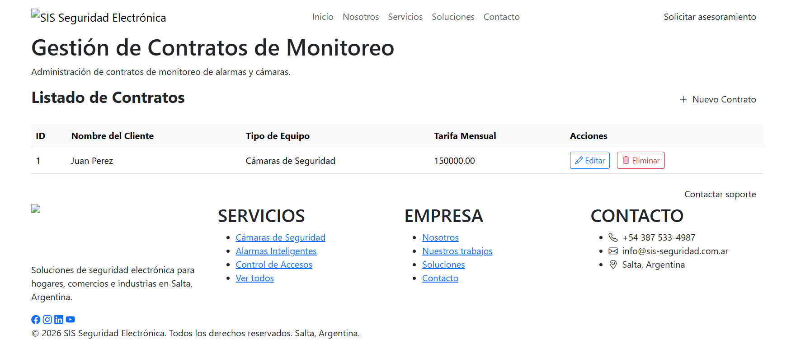

### Formulario de Crear
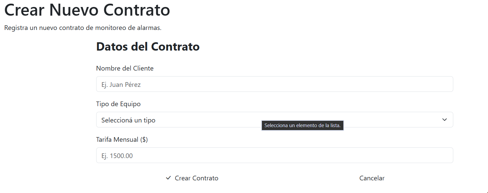

### Formulario de Editar
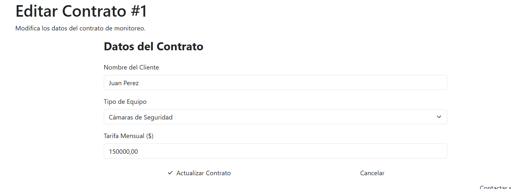

### Contrato Editado
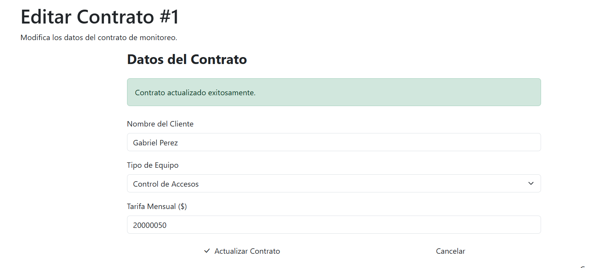

### Estructura de la Tabla en phpMyAdmin
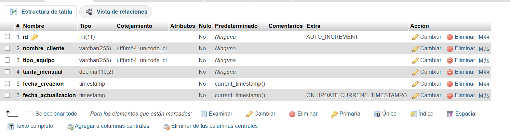

### Datos en Base de Datos
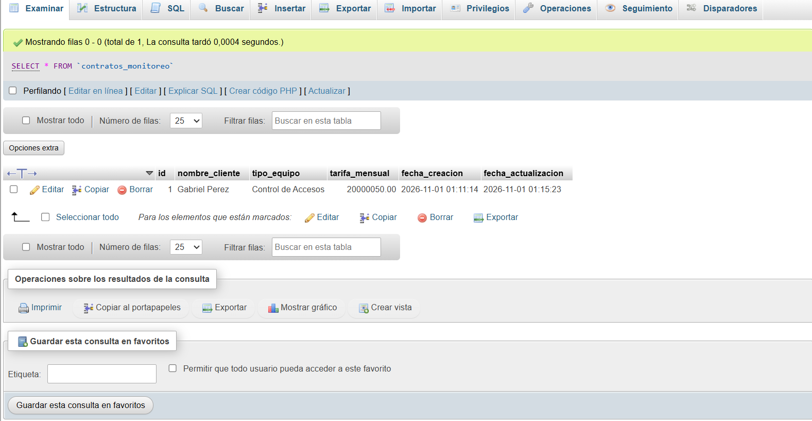

## Configuración de la Base de Datos

**Base de Datos:** sis_seguridad
**Charset:** utf8mb4
**Collation:** utf8mb4_unicode_ci

**Instrucciones de instalación:**
1. Ejecutar el script SQL en `config/crear_tabla.sql`
2. Configurar credenciales en `config/conexion.php` si es necesario
3. Acceder al módulo en `admin/index.php`

## Links de Acceso para Demostración

**Sitio Principal:**
- Inicio: http://localhost/Programacion-Web/index.php

**TP5 - Procesamiento de Formularios:**
- Formulario POST (Contacto): http://localhost/Programacion-Web/contacto.php
- Formulario POST (Asesoramiento): http://localhost/Programacion-Web/asesoramiento.php
- Formulario GET (Buscador): http://localhost/Programacion-Web/clase5/buscador.php

**TP7 - Módulo CRUD (Contratos de Monitoreo):**
- Listado de Contratos: http://localhost/Programacion-Web/admin/index.php
- Crear Contrato: http://localhost/Programacion-Web/admin/crear.php
- Editar Contrato: http://localhost/Programacion-Web/admin/editar.php?id=1
- Eliminar Contrato: http://localhost/Programacion-Web/admin/eliminar.php?id=1

**Base de Datos:**
- phpMyAdmin: http://localhost/phpmyadmin
- Base de datos: sis_seguridad
- Tabla: contratos_monitoreo

## Requisitos del Sistema

- PHP 7.4 o superior
- MySQL 5.7 o superior
- Extensión PDO habilitada
- Extensión PDO MySQL habilitada
- Servidor web local (XAMPP/Laragon)


