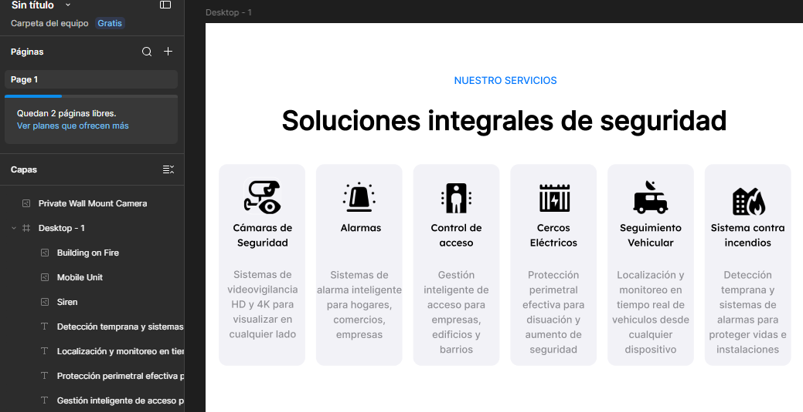

# TP - Diseño y planificación de sitio web

## 1. Intereses personales

Mis principales intereses están relacionados con la tecnología y la informática. Me interesa la programación, el desarrollo de páginas web, las redes, la reparación de computadoras y los sistemas de seguridad como cámaras y alarmas.

También me interesa aprender a desarrollar soluciones que puedan ser útiles para personas y empresas.

---

## 2. Tema elegido

Sitio web corporativo para una empresa de Seguridad Electrónica e Inteligente (SIS).
Justificación: Elegí este tema porque me permite aplicar mis intereses en el desarrollo web interactivo a un caso de uso real y de alta demanda. El rubro de la seguridad electrónica requiere un sitio que transmita confianza y solidez, lo que representa un gran desafío de diseño UI/UX. Además, me permite integrar herramientas interactivas que me interesan, como formularios de relevamiento a medida, botones de contacto rápido vía WhatsApp y secciones de asesoramiento dinámico para los usuarios.


## 3. Sitios web de referencia

Para este rubro, estas son 5 referencias del mercado de seguridad y tecnología con sus respectivos análisis para que incluyas en tu TP:

## ADT (adt.com.ar)

Positivos: Excelente jerarquía visual en los botones de "Llamada a la acción" (CTA); paleta de colores que transmite alerta y seguridad; buena adaptación a dispositivos móviles (responsive).

Negativos: Exceso de ventanas emergentes (pop-ups) comerciales; la carga de la página puede ser lenta por scripts de seguimiento; algunas secciones de texto son muy densas.

## Prosegur (prosegur.com.ar)

Positivos: Navegación por pestañas muy clara para separar "Hogares" de "Empresas"; portal de autogestión de clientes bien integrado; uso de iconografía intuitiva.

Negativos: El menú desplegable principal es demasiado extenso y puede confundir; los precios o planes base son difíciles de encontrar; el diseño del footer está sobrecargado de enlaces.

## X-28 Alarmas (x-28.com)

Positivos: Fuerte presencia de canales de contacto directo (WhatsApp visible en todo momento); explicaciones de productos muy directas y al grano; reconocimiento de marca local muy bien explotado.

Negativos: Interfaz de usuario (UI) un poco anticuada frente a la competencia; imágenes de producto de menor calidad; las transiciones entre páginas son algo toscas.

## Hikvision (hikvision.com)

Positivos: Fotografía de producto en altísima calidad; diseño web moderno y limpio; fichas técnicas de equipos extremadamente detalladas.

Negativos: Orientado más a instaladores/distribuidores que al consumidor final; lenguaje demasiado técnico; el mapa del sitio es muy profundo y complejo de navegar.

## Ring (ring.com)

Positivos: Interfaz minimalista y moderna orientada al "Smart Home"; excelente uso de videos cortos para demostrar cómo funciona el producto; proceso de compra integrado impecable.

Negativos: Ecosistema muy cerrado solo a sus productos; carece de secciones orientadas a soluciones empresariales complejas; soporte técnico difícil de contactar de forma directa.
# 4. Wireframes a mano

Se realizarán bocetos en papel para definir la estructura y distribución de los elementos principales del sitio web.


# 5. Mapa del sitio

La estructura general del sitio será la siguiente:
SITIO WEB
│
├── Inicio (Home)
│
├── Nosotros
│   └── La Empresa
│
├── Servicios
│   ├── Cámaras de Seguridad
│   ├── Sistemas de Alarmas
│   ├── Control de Accesos
│   ├── Cercos Eléctricos
│   ├── Seguimiento Vehicular
│   └── Sistemas contra Incendios
│
├── Soluciones
│   ├── Para Hogares
│   └── Para Comercios y Empresas
│
├── Contacto
│
└── Preguntas Frecuentes (FAQ)

## 6. WIDEFRAME EN FIGMA


# TP - Diseño de los mackup.
## HOME


## NOSOTROS


## SERVICIOS


## CONTACTO


## URL DE FIGMA https://www.figma.com/proto/jYodboH8pYuVJKtHmK5ATe/SIS-ALARMAS?node-id=17-4&p=f&t=YtLvM4Fk3mwMH3c2-1&scaling=min-zoom&content-scaling=fixed&page-id=0%3A1&starting-point-node-id=17%3A4

---

# Unidad 4 - Migración a PHP y Modularización (SSI)

## Descripción del Proyecto

Este proyecto consiste en un sitio web corporativo para **SIS Seguridad Electrónica**, una empresa de seguridad electrónica ubicada en Salta, Argentina. El sitio originalmente fue desarrollado como una maqueta estática en HTML/CSS/JavaScript y fue evolucionado en la Unidad 4 a una aplicación web basada en PHP utilizando la técnica de Server Side Includes (SSI/Modularización por plantillas).

### Refactorización Realizada

En la Unidad 4 se implementó:
- **Migración a PHP**: Todos los archivos `.html` fueron renombrados a `.php`
- **Modularización con SSI**: Extracción de componentes comunes (header, nav, footer) en plantillas reutilizables
- **Renderizado Server-Side (SSR)**: Implementación de títulos de página dinámicos y navegación activa
- **Variables de Entorno**: Configuración centralizada mediante archivo `config/env.php`
- **Eliminación de código duplicado**: Uso de `require_once` para incluir plantillas modulares

## Tecnologías Utilizadas

- **HTML5**: Estructura semántica del contenido
- **CSS3**: Estilos personalizados con variables CSS
- **Bootstrap 5.3.3**: Framework CSS para diseño responsive
- **Bootstrap Icons 1.11.3**: Iconografía del sitio
- **JavaScript**: Interactividad (acordeón FAQ, validación de formularios)
- **PHP 8.x**: Lógica server-side y modularización
- **XAMPP/Laragon**: Entorno de servidor local para ejecución
- **Git**: Control de versiones con flujo de trabajo por ramas

## Instrucciones de Instalación y Ejecución Local

### Requisitos Previos

1. Tener instalado un servidor local (XAMPP o Laragon)
2. Tener instalado Git
3. Tener un editor de código (VS Code recomendado)

### Pasos de Instalación

1. **Clonar el repositorio:**
   ```bash
   git clone [URL_DEL_REPOSITORIO]
   cd Programacion-Web
   ```

2. **Copiar el proyecto al servidor local:**
   - Si usas XAMPP: Copia la carpeta del proyecto a `C:\xampp\htdocs\`
   - Si usas Laragon: Copia la carpeta del proyecto a `C:\laragon\www\`

3. **Configurar variables de entorno (opcional):**
   - El archivo `config/env.php` ya contiene las configuraciones por defecto
   - Puedes crear un archivo `.env` local con tus propias configuraciones (este archivo no se versiona)

4. **Iniciar el servidor local:**
   - Abre el panel de control de XAMPP o Laragon
   - Inicia Apache

5. **Acceder al sitio:**
   - Abre tu navegador
   - Navega a `http://localhost/Programacion-Web/` (o el nombre de la carpeta que hayas usado)

## Estructura del Proyecto

```
Programacion-Web/
├── config/
│   └── env.php              # Variables de configuración global
├── includes/
│   ├── header.php           # Plantilla del encabezado y navegación
│   └── footer.php           # Plantilla del pie de página
├── css/
│   └── styles.css           # Hoja de estilos principal
├── js/
│   └── main.js              # Scripts JavaScript
├── imagen/                  # Imágenes del sitio
├── img/                     # Mockups y wireframes
├── index.php                # Página principal
├── nosotros.php             # Página "Nosotros"
├── servicios.php            # Página de servicios
├── contacto.php             # Página de contacto
├── soluciones.php           # Página de soluciones
├── trabajos.php             # Página de trabajos
├── asesoramiento.php        # Formulario de asesoramiento
├── camaras.php              # Página de cámaras
├── alarmas.php              # Página de alarmas
├── accesos.php              # Página de control de accesos
├── .env.example             # Plantilla de variables de entorno
├── .gitignore               # Archivos excluidos de Git
└── readme.md                # Documentación del proyecto
```

## Evidencia de Funcionamiento

### 1. Servidor Local Ejecutándose
[Captura del sitio corriendo en el navegador bajo http://localhost/Programacion-Web/]

### 2. Estructura Modular (SSI)
[Capturas del código fuente mostrando includes/header.php y includes/footer.php]

### 3. Navegación Dinámica
[Captura que demuestre el cambio de título dinámico en la pestaña del navegador y la clase active en el menú]

### 4. Configuración de Variables de Entorno
[Captura del archivo .env.example presente en el repositorio]

